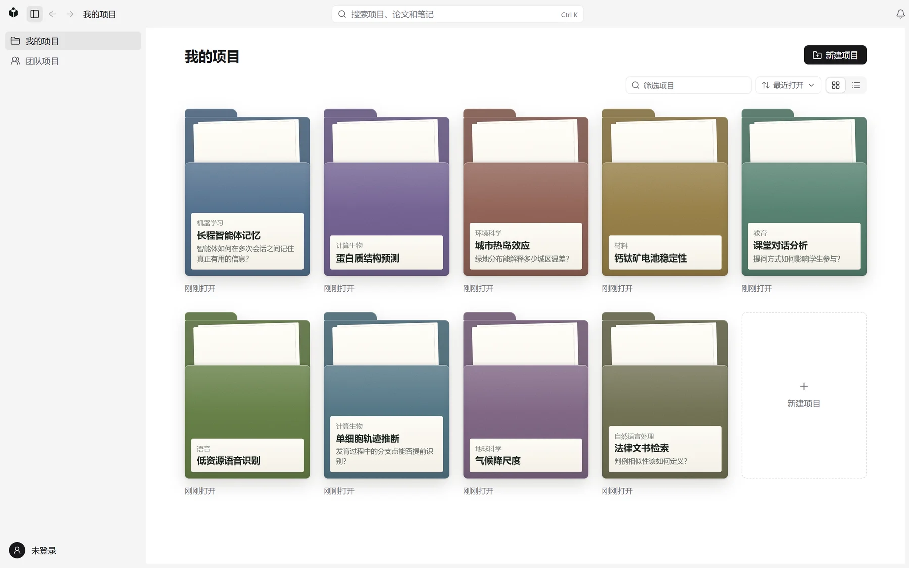
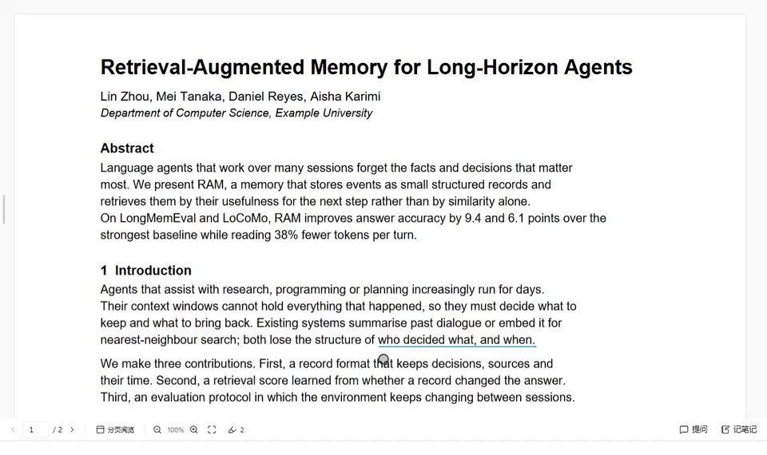
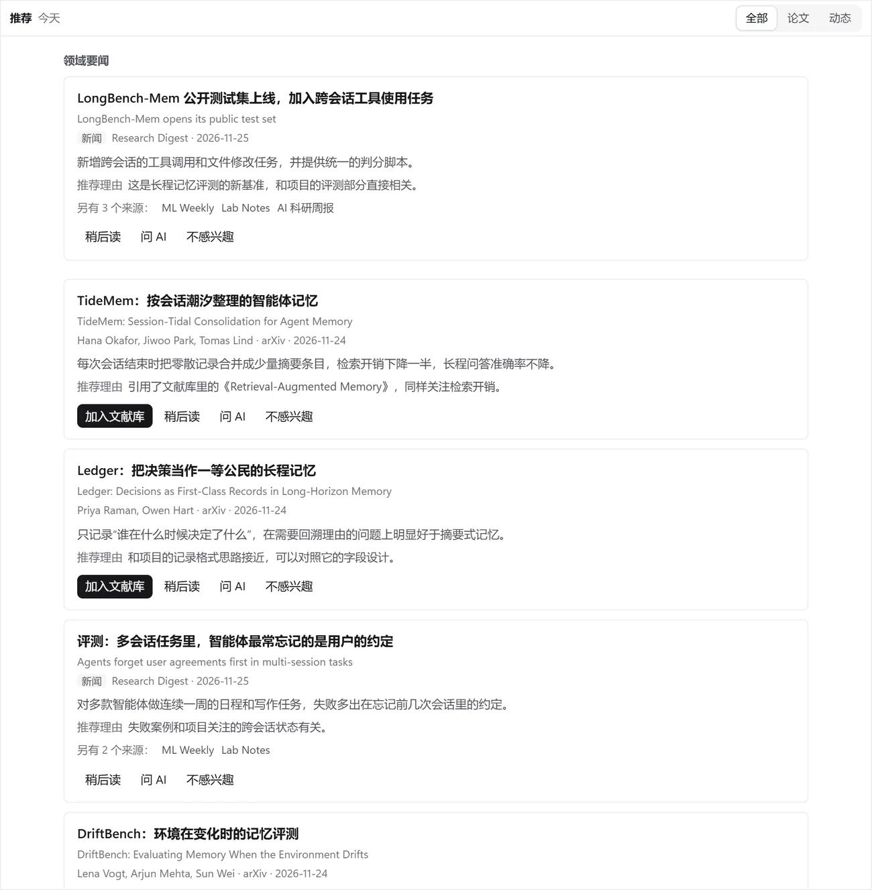
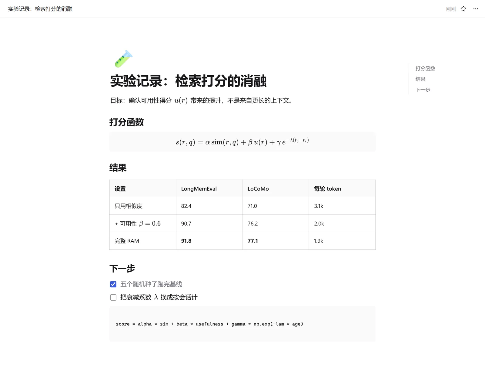
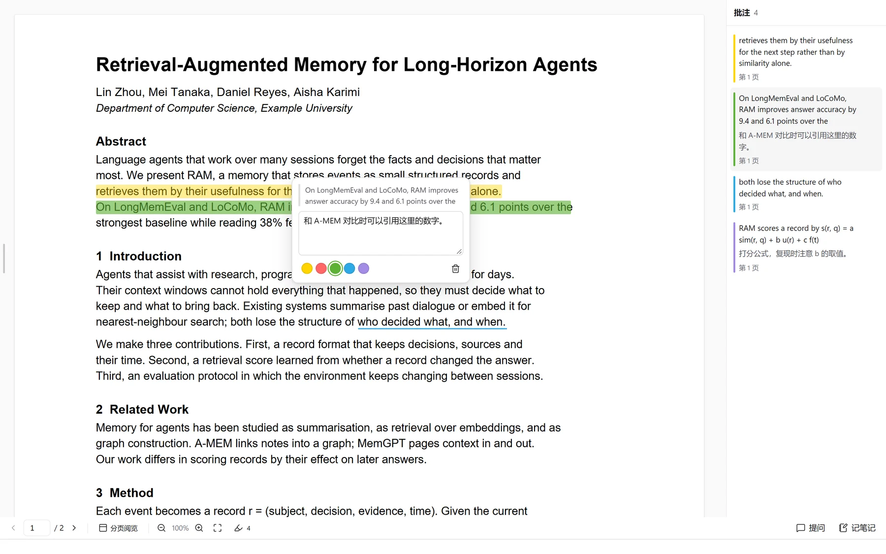
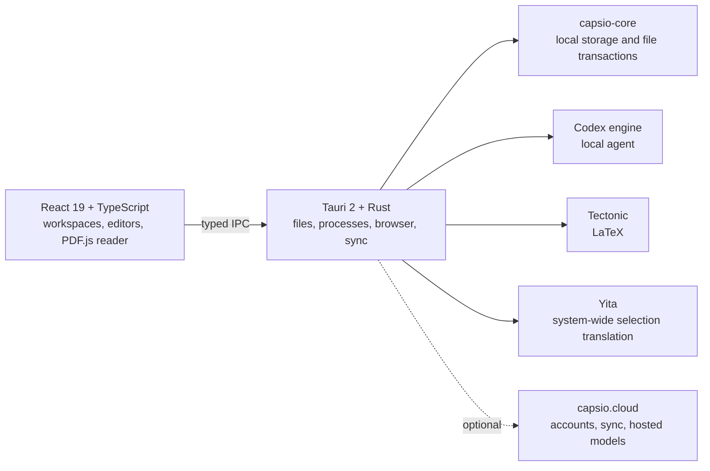

<p align="center">
  <a href="https://capsio.cloud"></a>
</p>

<p align="center">
  <a href="https://capsio.cloud"><b>Website</b></a> ·
  <a href="https://capsio.cloud/download/"><b>Download</b></a> ·
  <a href="https://capsio.cloud/docs/">Docs</a> ·
  <a href="https://capsio.cloud/changelog/">Changelog</a> ·
  <a href="https://capsio.cloud/discuss/">Community</a> ·
  <a href="README.md">简体中文</a>
</p>

<p align="center">
  <a href="https://capsio.cloud/download/"></a>
  
  <a href="https://github.com/2214331539/Capsio/actions/workflows/macos.yml"></a>
  <a href="LICENSE"></a>
  <a href="https://github.com/2214331539/Capsio/stargazers"></a>
</p>

<p align="center">
  <picture>
    <source media="(prefers-color-scheme: dark)" srcset="docs/readme/center-dark.webp">
    
  </picture>
</p>

**Capsio is a desktop workspace for researchers.** Read papers, take notes, write and run experiments, and write your LaTeX paper, all inside one project. The built-in assistant is a real local agent: it reads and writes your project files, searches the web and scholarly databases, and runs commands, with every step open to approval and undo.

A research project usually means switching between arXiv, a PDF reader, ChatGPT, Google Scholar, VS Code, Git and Overleaf. Capsio puts them behind one entry point. Your files stay your files; the tools follow the project you are working on.

> The interface is in Chinese and English (Settings → Language). Screenshots show the Chinese interface.

## Features

<table>
  <tr>
    <td width="50%" valign="top">
      <h3>📄 Papers: read, mark, translate, organize</h3>
      <p>A folder tree of local PDFs with highlights, underlines, comments and notes. Full-text translation keeps the original layout, and selection translation works in any app. Move over from Zotero, BibTeX or RIS with collections, notes and highlights.</p>
    </td>
    <td width="50%" valign="top">
      <h3>🗞️ Recommendations: worth reading today</h3>
      <p>A daily brief for each project, from its research direction: new papers, news and blog posts, each with the reason it was picked. New work citing a paper in your library is flagged right away.</p>
    </td>
  </tr>
  <tr>
    <td valign="top">
      <h3>🤖 Assistant: a local agent</h3>
      <p>Built on the OpenAI Codex engine, it works in your project folders: reads and writes files, runs commands, searches the web and scholarly databases. Four permission levels, step approval, undo a turn, MCP and custom instructions. Use the hosted models or your own provider.</p>
    </td>
    <td valign="top">
      <h3>🧪 Experiments: a code workbench for research</h3>
      <p>Editor, Python and Conda environments, terminals, Git (diffs, staging, branches, stashes, worktrees) and SSH to remote hosts. CSV, notebooks, images, PDF, Word and PowerPoint open in place.</p>
    </td>
  </tr>
  <tr>
    <td valign="top">
      <h3>✍️ Writing: a local Overleaf</h3>
      <p>Tectonic with common packages built in, so it compiles offline. SyncTeX both ways, <code>\cite</code> searches your library and fills the bib. Import from Overleaf, export a source bundle for submission.</p>
    </td>
    <td valign="top">
      <h3>📝 Docs: a block editor</h3>
      <p>Headings, formulas, tables, to-dos, code, attachments and link cards, exported to Word. Zoom with Ctrl + wheel or a pinch. Markdown and formulas from the assistant keep their shape.</p>
    </td>
  </tr>
</table>

### Reading and annotating

Select text to highlight, underline, comment, quote it into a note or ask the assistant. The annotation list follows reading order and takes you back to each mark.

<p align="center">
  
</p>

<table>
  <tr>
    <td width="50%"></td>
    <td width="50%"></td>
  </tr>
  <tr>
    <td align="center"><sub>Daily recommendations, each with a reason</sub></td>
    <td align="center"><sub>Docs with formulas, tables, to-dos and code</sub></td>
  </tr>
</table>

<p align="center">
  
  <br><sub>The PDF reader: highlights in several colors, underlines, comments and the annotation list</sub>
</p>

## Download

Get the latest version at **[capsio.cloud/download](https://capsio.cloud/download/)**. Installed copies check for updates in the app; on Windows they install silently in the background.

| Platform | Requirements | Installer |
| --- | --- | --- |
| Windows | Windows 10 / 11, x64 | `Capsio_windows_x64_setup.exe` |
| macOS | macOS 14 or later, Apple Silicon (M series) | `Capsio_macos_arm64.dmg` |

> [!NOTE]
> Capsio is an **alpha preview**. The Windows installer is not signed yet and may show "Unknown publisher". The Mac build is ad-hoc signed and not notarized: the first time, choose "Open Anyway" in System Settings → Privacy & Security. Intel Macs, Linux and mobile are not supported yet.

## Run from source

You need [Node.js 24 LTS](https://nodejs.org/), pnpm 10.11.0 and stable Rust. On Windows, also the [MSVC C++ build tools and WebView2](https://v2.tauri.app/start/prerequisites/#windows); on a Mac, macOS 14+ and the [Xcode command line tools](https://v2.tauri.app/start/prerequisites/#macos), with native arm64 Node and Rust.

```bash
git clone https://github.com/2214331539/Capsio.git
cd Capsio
corepack enable && corepack prepare pnpm@10.11.0 --activate
pnpm install --frozen-lockfile
pnpm start
```

The first start prepares PDF resources and downloads pinned versions of the agent and LaTeX engines from GitHub. `pnpm dev` only previews the interface in a browser, without file access, terminals or experiment runs; it is not a web version.

<details>
<summary><b>Packaging and checks</b></summary>

```bash
# A local executable, without an installer
pnpm tauri build --no-bundle

# Windows NSIS installer, in target/release/bundle/nsis/
node node_modules/@tauri-apps/cli/tauri.js build --bundles nsis -- --locked

# macOS DMG, in target/release/bundle/dmg/
node node_modules/@tauri-apps/cli/tauri.js build --bundles app,dmg -- --locked

# Checks (run pnpm run build once first, to prepare resources Git ignores)
pnpm check && pnpm test
cargo fmt --all --check
cargo test --workspace --locked
cargo clippy --workspace --all-targets --locked -- -D warnings
```

Releases with in-app updates are built by `scripts/build-release.mjs`; see the [development workflow](docs/开发流程/开发与验收流程.md) and [release process](docs/技术方案/版本发布与分支管理.md) (in Chinese).

</details>

## Architecture



```text
src/                  React workspaces, editors, PDF reader and typed IPC
src-tauri/            Desktop window, files, processes, browser, agent and sync
crates/capsio-core/   Local storage, validation and file transactions
server/               Collaboration service (accounts, sync, billing, admin)
vendor/yita/          Selection translation component
scripts/              Resource preparation, packaging, release and verification
docs/                 Product design, technical notes, workflow and release records
```

## Data and privacy

- **Your files stay local.** PDFs, notes and code live in your own folders. App data is in `CapsioData/` beside the installation on Windows and in `~/Library/Application Support/Capsio/` on a Mac; you can move it in Settings.
- **Sync is optional.** Signed in, your devices keep the same projects and you can invite collaborators. Assistant conversations stay on your computer.
- **You decide what the assistant sends.** With a remote model, the text you select or the files the agent reads go to the provider you configured; every write and command can require your approval.
- Model keys are currently stored in an unencrypted credentials file on your computer; do not share the whole data folder. See [Security](SECURITY.md) and the [desktop guide](docs/使用说明/桌面使用说明.md).

## Contributing

Code, docs, translations, bug reports and research use cases are all welcome. Read the [contributing guide](CONTRIBUTING.md) and [code of conduct](CODE_OF_CONDUCT.md) first: small fixes can go straight to a PR; new features, dependencies or data format changes start with an issue. See also the [roadmap](ROADMAP.md) and [governance](GOVERNANCE.md).

- Bugs and ideas: [GitHub Issues](https://github.com/2214331539/Capsio/issues)
- Discussion: [Capsio community](https://capsio.cloud/discuss/)

## License

Capsio's original code and documentation are licensed under the [Apache License 2.0](LICENSE). Third-party components keep their own licenses; see [third-party notices](THIRD_PARTY_NOTICES.md). The license does not grant rights to the Capsio name or logo.

Thanks to the maintainers of [Tauri](https://tauri.app), [React](https://react.dev), [PDF.js](https://mozilla.github.io/pdf.js/), [CodeMirror](https://codemirror.net), [Tiptap](https://tiptap.dev), [xterm.js](https://xtermjs.org), [Tectonic](https://tectonic-typesetting.github.io), [OpenAI Codex](https://github.com/openai/codex), [BabelDOC](https://github.com/funstory-ai/BabelDOC) and many others. Capsio is an independent project with no affiliation to them.
