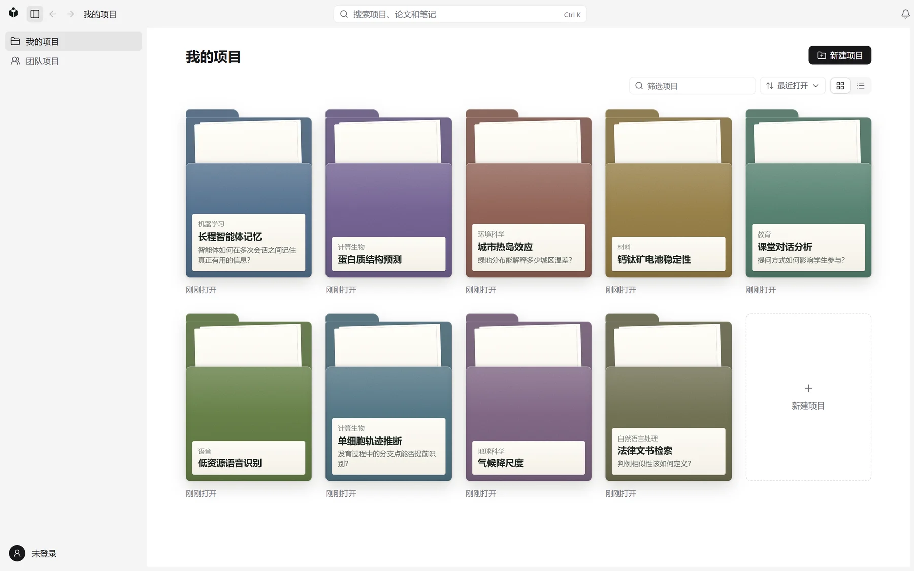
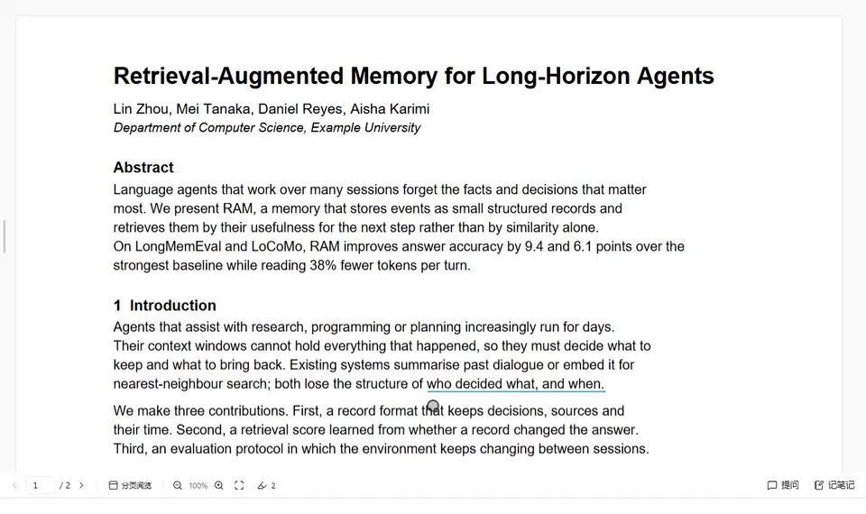
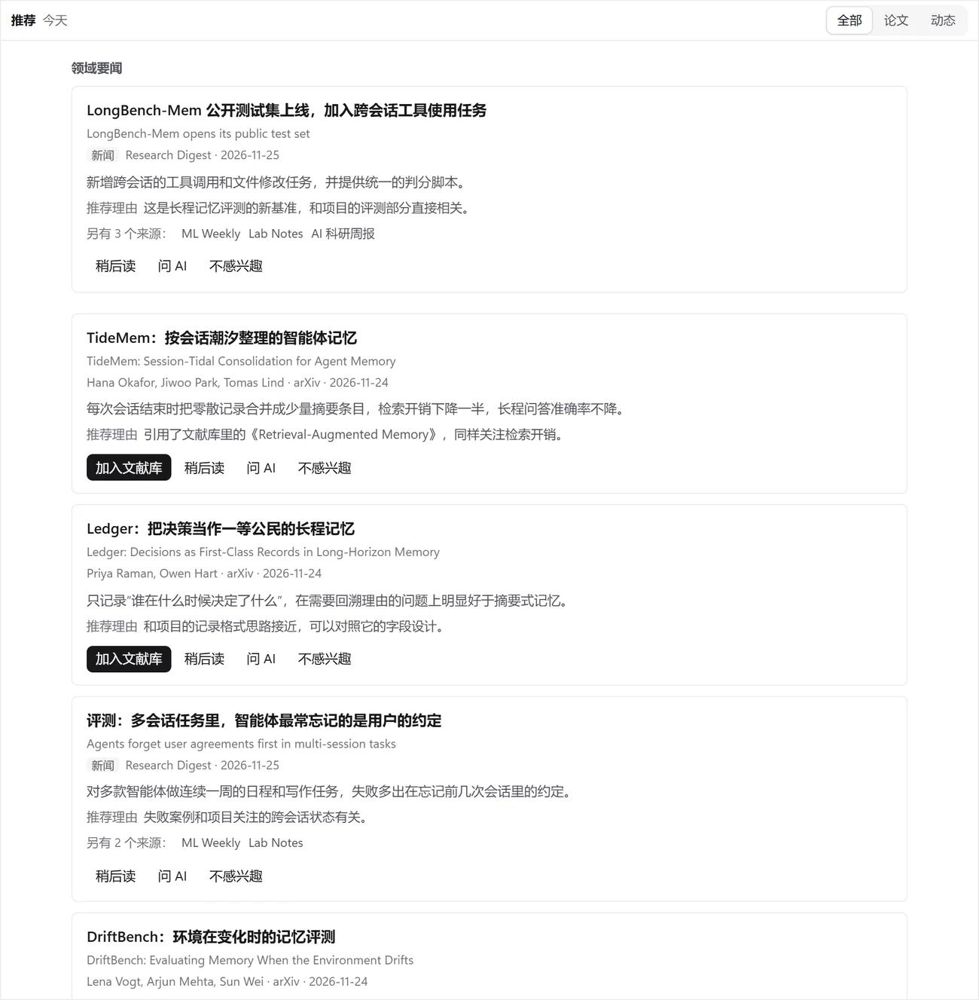
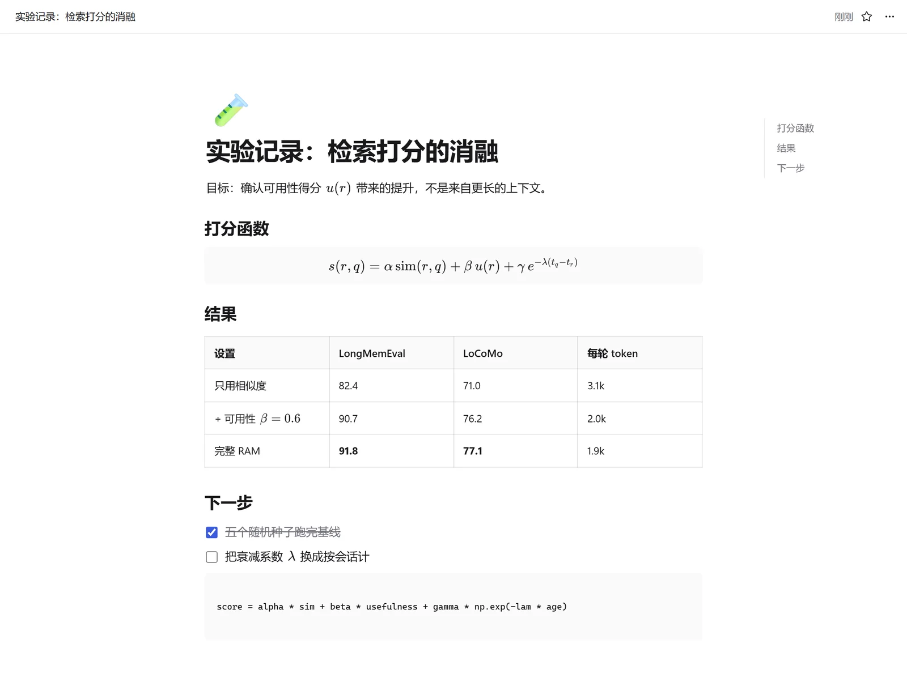
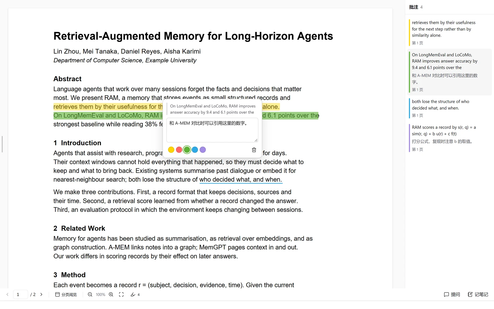
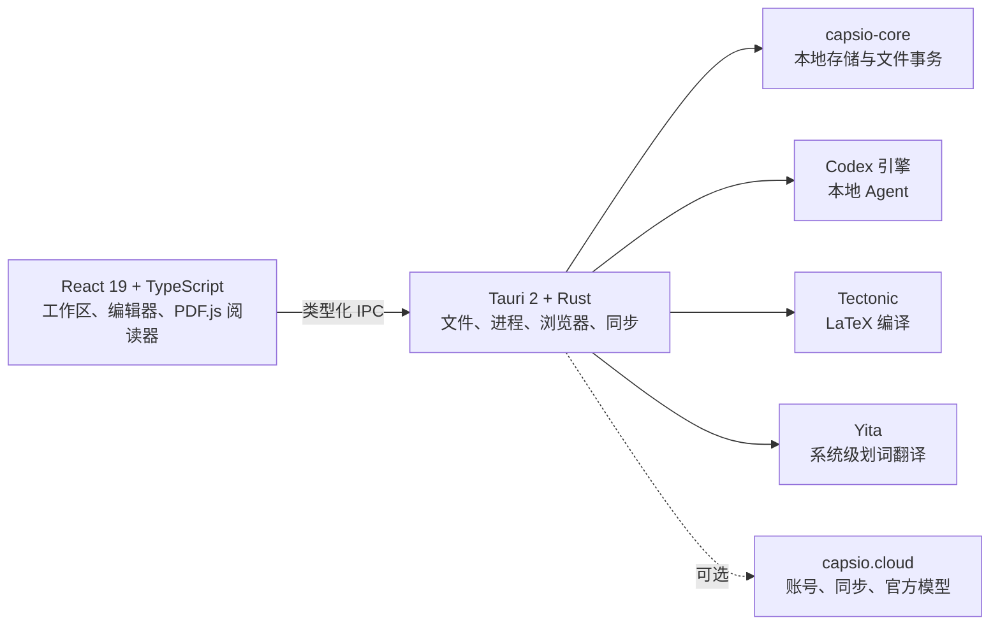

<p align="center">
  <a href="https://capsio.cloud"></a>
</p>

<p align="center">
  <a href="https://capsio.cloud"><b>官网</b></a> ·
  <a href="https://capsio.cloud/download/"><b>下载</b></a> ·
  <a href="https://capsio.cloud/docs/">文档</a> ·
  <a href="https://capsio.cloud/changelog/">更新日志</a> ·
  <a href="https://capsio.cloud/discuss/">社区</a> ·
  <a href="README.en.md">English</a>
</p>

<p align="center">
  <a href="https://capsio.cloud/download/"></a>
  
  <a href="https://github.com/2214331539/Capsio/actions/workflows/macos.yml"></a>
  <a href="LICENSE"></a>
  <a href="https://github.com/2214331539/Capsio/stargazers"></a>
</p>

<p align="center">
  <picture>
    <source media="(prefers-color-scheme: dark)" srcset="docs/readme/center-dark.webp">
    
  </picture>
</p>

**Capsio 是面向研究者的桌面工作台。** 读论文、记笔记、写代码跑实验、写 LaTeX 论文，都在同一个项目里完成；内置的 AI 助手是一个真正的本地 Agent，能读写你的项目文件、联网检索、运行命令，每一步都可以审批和撤销。

做一个课题，往往要在 arXiv、PDF 阅读器、ChatGPT、Google Scholar、VS Code、Git 和 Overleaf 之间来回切换。Capsio 把这些放进一个入口：文件还是你自己的文件，工具都围着当前的项目转。

## 功能一览

<table>
  <tr>
    <td width="50%" valign="top">
      <h3>📄 文献：读、标、译、管</h3>
      <p>本地 PDF 目录树，高亮、下划线、批注和便签；全文翻译保留原版式，任意应用里划词即译。Zotero、BibTeX、RIS 一键迁入，分类、笔记和高亮都带过来。</p>
    </td>
    <td width="50%" valign="top">
      <h3>🗞️ 推荐：每天值得读的</h3>
      <p>按项目的研究方向，每天整理一份简报：新论文、新闻和博客，每条写明推荐理由。有新工作引用了你文献库里的论文时，会即时提醒。</p>
    </td>
  </tr>
  <tr>
    <td valign="top">
      <h3>🤖 AI 助手：本地 Agent</h3>
      <p>基于 OpenAI Codex 引擎，在你的项目目录里读写文件、运行命令、联网搜索和检索学术数据库。四档权限、逐步审批、撤销本轮、MCP 和自定义指令；可用官方模型，也可接入自己的模型服务。</p>
    </td>
    <td valign="top">
      <h3>🧪 实验：面向科研的代码工作台</h3>
      <p>编辑器、Python 与 Conda 环境、终端、Git（差异、暂存、分支、储藏、worktree），以及 SSH 连接云主机。CSV、Notebook、图片、PDF、Word、PPT 都能直接打开。</p>
    </td>
  </tr>
  <tr>
    <td valign="top">
      <h3>✍️ 写作：本地的 Overleaf</h3>
      <p>内置 Tectonic 和常用宏包，离线也能编译；SyncTeX 双向跳转，<code>\cite</code> 直接搜文献库并写入 bib；可从 Overleaf 导入，也能导出投稿用的源码包。</p>
    </td>
    <td valign="top">
      <h3>📝 文档：块编辑器</h3>
      <p>标题、公式、表格、待办、代码、附件和链接卡片，导出 Word；Ctrl + 滚轮或双指缩放。AI 写出的 Markdown 和公式插入后原样保留。</p>
    </td>
  </tr>
</table>

### 阅读与批注

选中文字即可高亮、下划线、批注、摘录到笔记或交给 AI；批注列表按阅读顺序排列，点一下跳回原处。

<p align="center">
  
</p>

<table>
  <tr>
    <td width="50%"></td>
    <td width="50%"></td>
  </tr>
  <tr>
    <td align="center"><sub>每日推荐：论文和动态，每条附推荐理由</sub></td>
    <td align="center"><sub>文档：公式、表格、待办与代码</sub></td>
  </tr>
</table>

<p align="center">
  
  <br><sub>PDF 阅读器：多色高亮、下划线、批注和批注列表</sub>
</p>

## 下载

前往 **[capsio.cloud/download](https://capsio.cloud/download/)** 下载最新版本。安装后会在应用内检查更新，Windows 在后台静默安装。

| 平台 | 系统要求 | 安装包 |
| --- | --- | --- |
| Windows | Windows 10 / 11，x64 | `Capsio_windows_x64_setup.exe` |
| macOS | macOS 14 及以上，Apple Silicon（M 系列） | `Capsio_macos_arm64.dmg` |

> [!NOTE]
> Capsio 目前是 **Alpha 预览版**。Windows 安装包尚未签名，可能提示“未知发布者”；Mac 版为 ad-hoc 签名、未公证，首次打开请在“系统设置 → 隐私与安全性”里点“仍要打开”。暂不提供 Intel Mac、Linux 和移动端版本。

## 从源码运行

需要 [Node.js 24 LTS](https://nodejs.org/)、pnpm 10.11.0 和 Rust stable。Windows 还需要 [MSVC C++ 生成工具与 WebView2](https://v2.tauri.app/start/prerequisites/#windows)；Mac 需要 macOS 14+ 和 [Xcode 命令行工具](https://v2.tauri.app/start/prerequisites/#macos)，请使用原生 arm64 的 Node 与 Rust。

```bash
git clone https://github.com/2214331539/Capsio.git
cd Capsio
corepack enable && corepack prepare pnpm@10.11.0 --activate
pnpm install --frozen-lockfile
pnpm start
```

首次启动会准备 PDF 资源，并从 GitHub 下载固定版本的 Agent 引擎和 LaTeX 引擎。`pnpm dev` 只启动浏览器里的界面预览，没有文件访问、终端和实验运行，不能当作 Web 版使用。

<details>
<summary><b>打包与检查</b></summary>

```bash
# 本机可执行程序（不打安装包）
pnpm tauri build --no-bundle

# Windows NSIS 安装包，产物在 target/release/bundle/nsis/
node node_modules/@tauri-apps/cli/tauri.js build --bundles nsis -- --locked

# macOS DMG，产物在 target/release/bundle/dmg/
node node_modules/@tauri-apps/cli/tauri.js build --bundles app,dmg -- --locked

# 检查（先运行一次 pnpm run build，准备被 Git 忽略的资源）
pnpm check && pnpm test
cargo fmt --all --check
cargo test --workspace --locked
cargo clippy --workspace --all-targets --locked -- -D warnings
```

带应用内更新的正式版本由 `scripts/build-release.mjs` 打包，流程见[开发与验收流程](docs/开发流程/开发与验收流程.md)和[版本发布](docs/技术方案/版本发布与分支管理.md)。

</details>

## 架构



```text
src/                  React 工作区、编辑器、PDF 阅读器与类型化 IPC
src-tauri/            桌面窗口、文件、进程、浏览器、Agent 与同步
crates/capsio-core/   本地存储、校验与文件事务
server/               协作服务（账号、同步、计费、管理后台）
vendor/yita/          划词翻译组件
scripts/              资源准备、打包、发布与验收工具
docs/                 产品设计、技术方案、开发流程与更新记录
```

更多见[总体架构](docs/技术方案/总体架构.md)。

## 数据与隐私

- **文件留在本地。** PDF、笔记和代码都在你自己的目录里；应用数据在 Windows 安装目录旁的 `CapsioData/`，Mac 在 `~/Library/Application Support/Capsio/`，可以在设置里迁移。
- **同步是可选的。** 登录后同一账号的多台设备自动同步项目，也可以邀请成员协作；AI 对话只存在本机。
- **AI 发送什么，由你决定。** 使用远程模型时，你选中的内容或 Agent 读取的文件会发给所配置的服务商；Agent 的每一次写入和命令都可以设置为需要审批。
- 模型密钥目前保存在本机未加密的凭据文件里，不要分享整个数据目录。完整说明见[安全说明](SECURITY.md)和[桌面使用说明](docs/使用说明/桌面使用说明.md)。

## 参与贡献

欢迎代码、文档、翻译、问题反馈和科研场景的使用案例。提交前请阅读[贡献指南](CONTRIBUTING.md)和[行为规范](CODE_OF_CONDUCT.md)：小修复可以直接发 PR，新功能、新依赖或数据结构的改动请先开 Issue 讨论。路线图见 [ROADMAP.md](ROADMAP.md)，治理方式见 [GOVERNANCE.md](GOVERNANCE.md)。

- 问题与建议：[GitHub Issues](https://github.com/2214331539/Capsio/issues)
- 交流与讨论：[Capsio 社区](https://capsio.cloud/discuss/)
- 文档索引：[docs/README.md](docs/README.md)

## 许可

Capsio 的原创代码和文档采用 [Apache License 2.0](LICENSE)，第三方组件遵循各自的许可，见[第三方声明](THIRD_PARTY_NOTICES.md)。许可证不授予 Capsio 名称和标志的商标使用权。

感谢 [Tauri](https://tauri.app)、[React](https://react.dev)、[PDF.js](https://mozilla.github.io/pdf.js/)、[CodeMirror](https://codemirror.net)、[Tiptap](https://tiptap.dev)、[xterm.js](https://xtermjs.org)、[Tectonic](https://tectonic-typesetting.github.io)、[OpenAI Codex](https://github.com/openai/codex)、[BabelDOC](https://github.com/funstory-ai/BabelDOC) 等项目的维护者。Capsio 是独立项目，与这些项目及其维护组织没有隶属关系。
